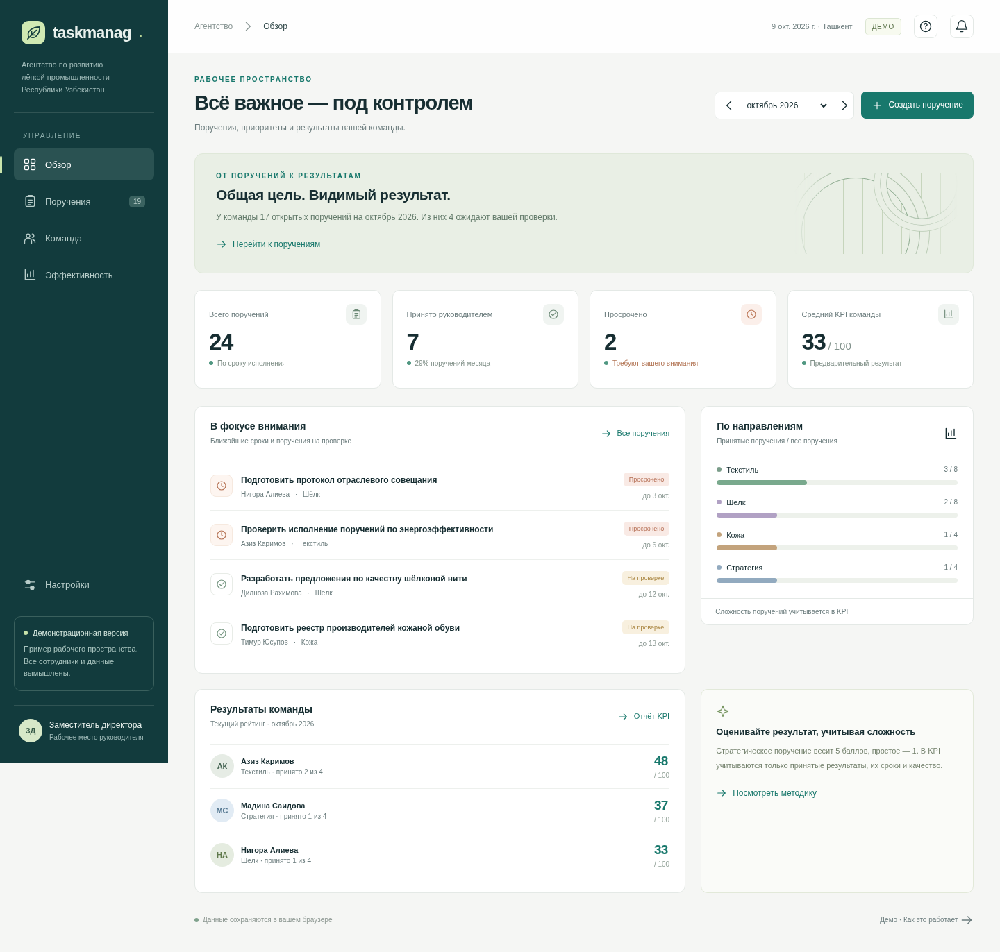

# Taskmanag — демонстрационный портал

Русскоязычный прототип для руководителя Агентства по развитию лёгкой промышленности Республики Узбекистан. Все имена и данные вымышлены.

**Установка на собственный сервер:** [инструкция для IT-команды](DEPLOYMENT.md).



## Открыть демо

Откройте `demo.html` в современном браузере. Это один автономный файл: интернет, регистрация и установка библиотек не требуются. Изменения сохраняются в локальном хранилище браузера. Если браузер запрещает хранение для локальных файлов, используйте резервные копии JSON или локальный HTTP-сервер:

```sh
cd taskmanag
npm start
```

Сервер использует порт 4173. Это способ локального запуска, не публичная публикация. В облачном интерфейсе onboarding веб-превью не поддерживается — используйте скачанный HTML-файл для просмотра.

## Что проверить за пять минут

1. На странице **Обзор** посмотрите текущий месяц: сроки, поручения на проверке, состояние направлений.
2. В разделе **Команда** добавьте сотрудника.
3. В разделе **Поручения** создайте задачу: назначьте сотрудника, срок, сложность, чек-лист и при необходимости предварительные поручения.
4. Откройте карточку, отметьте этапы, заполните отчёт об исполнении, выберите **На проверке** и сохраните ход исполнения.
5. Нажмите **Принять результат**, подтвердите фактическую дату выполнения и оценку качества.
6. В разделе **Эффективность** выберите месяц срока поручения и проверьте результат. Скачайте отчёт CSV для Excel. Предыдущий месяц содержит более полный пример результатов команды.
7. В **Настройках** измените веса KPI или скачайте JSON-копию рабочего пространства.

## Возможности

- Обзор по месяцам, направлениям, просроченным задачам и результатам команды.
- Список и доска поручений; поиск, фильтры по статусу, направлению и сотруднику.
- Назначение и редактирование задач, четыре уровня сложности, сроки и приоритеты.
- Чек-листы, зависимости с проверкой циклов, текстовые отчёты и комментарии.
- Проверка результата руководителем, оценка качества, возвращение в работу.
- Сотрудники, загрузка и индивидуальные результаты.
- Ежемесячный KPI с настраиваемыми весами, выгрузка CSV, резервное копирование и восстановление JSON.
- Адаптивный интерфейс для компьютера и телефона; даты в часовом поясе Ташкента.

## Предлагаемая методика KPI

Поручения относятся к месяцу **срока исполнения**, независимо от месяца фактического завершения. Вес сложности: простая — 1, стандартная — 2, сложная — 3, стратегическая — 5 баллов. В числителе учитываются только принятые руководителем результаты.

- Выполнение: принятые баллы / все назначенные баллы месяца × 100.
- Сроки: баллы принятых поручений, выполненных не позднее срока / все баллы месяца × 100.
- Качество: сумма (баллы принятой задачи × качество / 5) / все баллы месяца × 100.
- KPI: выполнение × 50% + сроки × 30% + качество × 20%. Веса можно изменить, их сумма должна составлять 100%.

Пустой месяц даёт «—», а не нулевую оценку. Среднее команды — арифметическое среднее по сотрудникам с поручениями. Округляется только отображаемое значение. Задачи на проверке, незавершённые задачи и их процент прогресса не дают принятых баллов. Приоритет не увеличивает KPI. Дата фактического выполнения подтверждается руководителем при принятии и определяет соблюдение срока.

Текущий месяц включает ещё не наступившие сроки: результат предварительный. Позднее принятие и редактирование исходных данных пересчитывают прошлые месяцы. Закрытие и фиксация периодов в прототипе не реализованы. Формула предложена для обсуждения и не является утверждённой методикой Агентства.

## Ограничения демонстрации

Это локальный интерфейс одного пользователя: нет авторизации, общей базы данных, синхронизации, рассылки уведомлений или загрузки файлов. Руководитель и исполнитель действуют из одной карточки; история изменений демонстрационная и не является защищённым аудитом. Ссылки и сведения о документах сохраняются как текст. Очистка браузера удаляет локальные данные. Для рабочей версии потребуется согласовать роли, методику, хранение документов и развёртывание серверной части.

## Разработка и проверка

Необходим Node.js 20+; для локального сервера — Python 3. Зависимости для сборки и модульных тестов не нужны.

```sh
npm run build
npm test
npm start
```

`src/domain.js` содержит расчёты и валидацию, `src/app.js` — интерфейс и сценарии, `src/styles.css` — оформление. `scripts/build.js` собирает всё в `demo.html`; редактируйте исходники, затем пересобирайте демо.

Проверено: 11 тестов расчётов и валидации; браузерный сценарий создания сотрудника и задачи, прохождения чек-листа, проверки и принятия с KPI 96, смены месяца, скачивания CSV, сохранения после перезагрузки, возврата в работу, валидации весов, экспорта/импорта JSON, сброса, доски и мобильного интерфейса. Работа проверена через локальный HTTP: управляемый браузер облачной среды блокирует навигацию `file://` своей политикой. В автономном HTML нет внешних ресурсов или сетевых запросов.

Необязательный браузерный тест требует Playwright 1.58.2 и Chromium. Пример установки отдельно от проекта:

```sh
npm install --prefix /tmp/taskmanag-browser --cache /tmp/taskmanag-npm-cache playwright@1.58.2 --no-audit --no-fund
PLAYWRIGHT_MODULE=/tmp/taskmanag-browser/node_modules/playwright node tests/browser.cjs
```

Сначала запустите `npm start`. Тест использует системный `/usr/bin/chromium`; путь можно заменить через `CHROMIUM_PATH`, адрес демо — через `DEMO_URL`.
